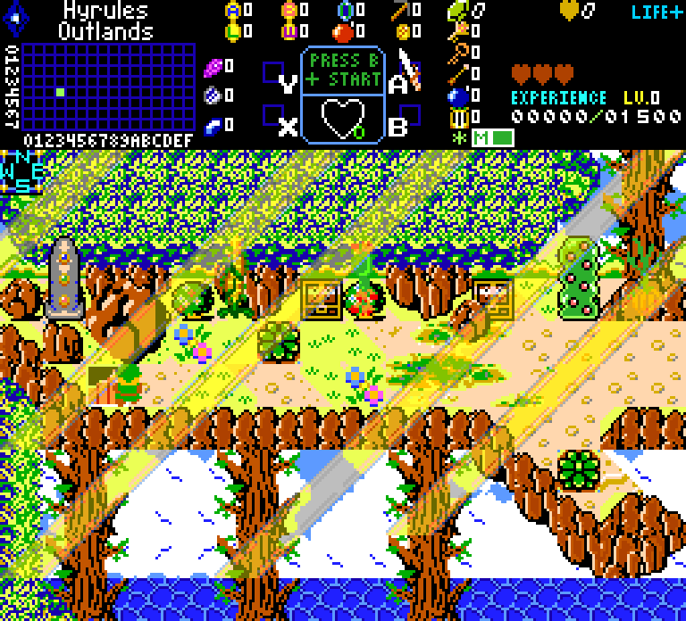
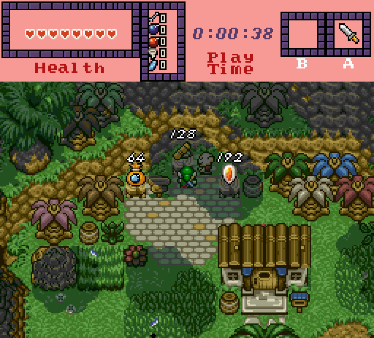
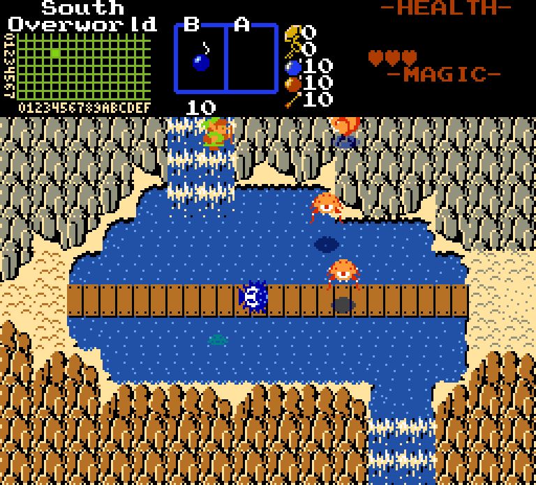
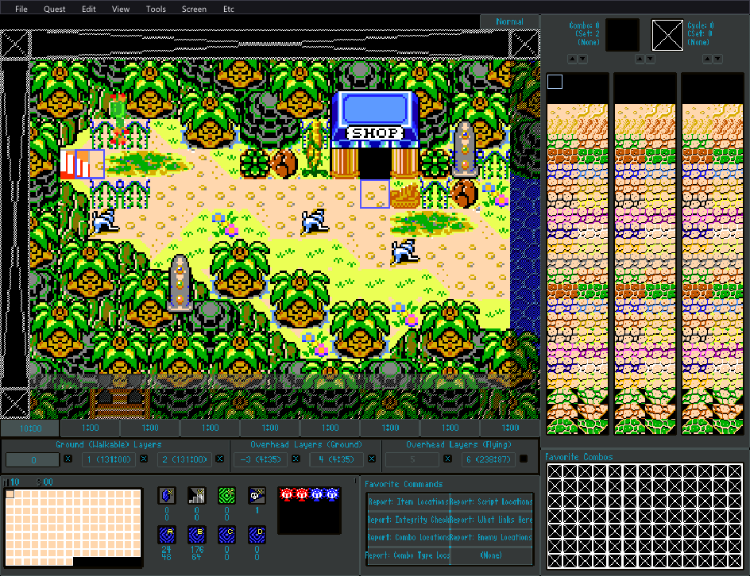
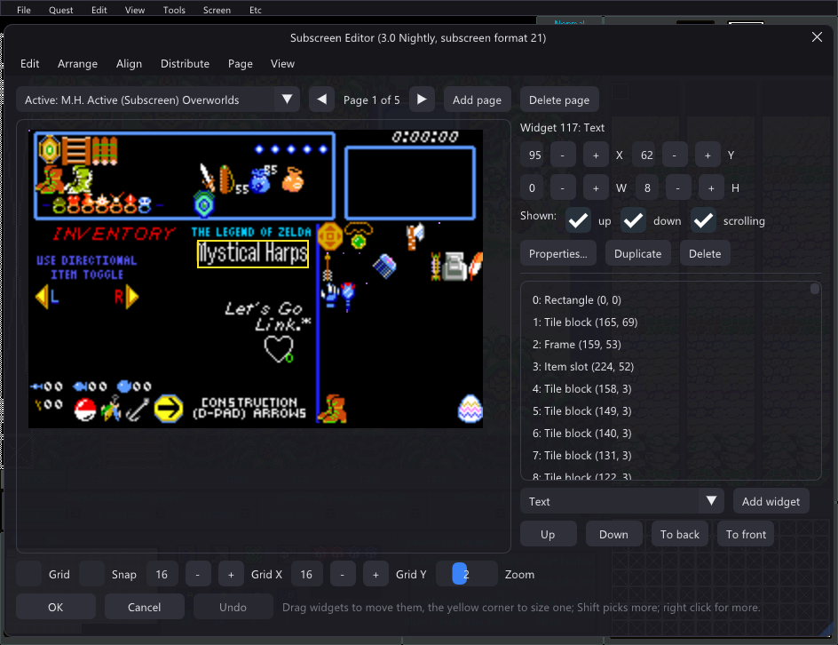
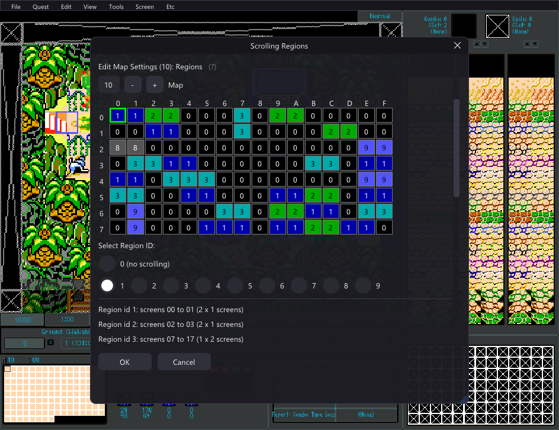
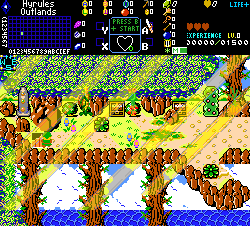
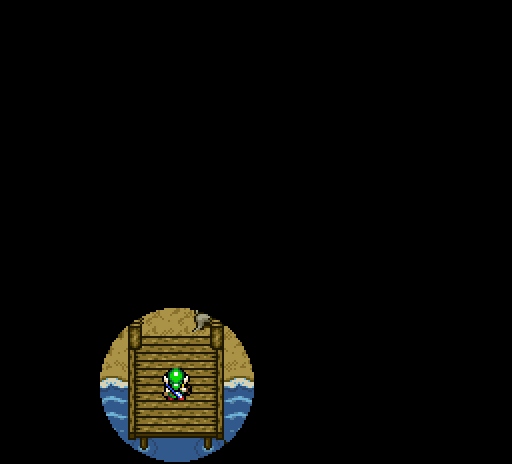
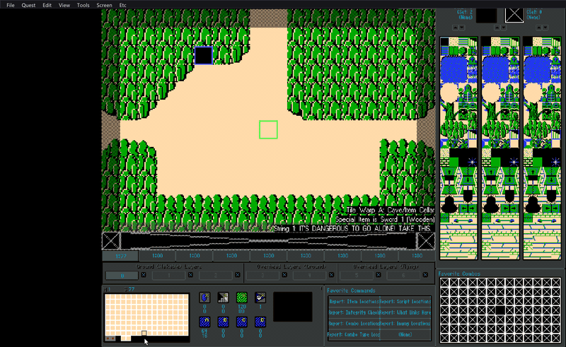

# ZC Vulkan 2.53.444.12

[](https://github.com/DevianceLe/Zelda-Classic-Vulkan/actions/workflows/build.yml)

> [!WARNING]
> **Highly experimental.** This fork is a work in progress. Expect bugs and crashes, and back up your quests and save files before you use it. A quest saved as 2.55.19 or 3.0 Nightly can't be opened by older versions of Zelda Classic.

Zelda Classic is a game engine and quest editor for making and playing custom adventures in the style of the original *The Legend of Zelda*. This repository is a community fork of Zelda Classic 2.53, rebuilt to run on SDL3 and Vulkan.

| Program | What it is | Runs on |
|---|---|---|
| `zplayer` | The game. Plays 2.53, 2.55 and 3.0 Nightly quests. | Windows 10/11 (32-bit, 64-bit, ARM64), Linux (64-bit x86_64, ARM64), macOS 11+ (Apple Silicon and Intel), Nintendo Switch (homebrew), Android 8.0+ (in progress) |
| `zqeditor` | ZQuest, the quest editor. Opens quests of every version, saves each in its own version, and saves older quests as 2.55.19 or 3.0 Nightly. Compiles 2.55 and 3.0 Nightly quests' ZScript with those versions' own compilers (`zscript255`, `zscript30`). | Windows 10/11 (32-bit, 64-bit, ARM64), Linux (64-bit x86_64, ARM64), macOS 11+ (Apple Silicon and Intel) |

## Screenshots

**zplayer**

| | | |
|:-:|:-:|:-:|
|  |  |  |
| Mystical Harps | Soldier's Test | Link's Rise 2 DX |

**ZQuest**

| | | |
|:-:|:-:|:-:|
|  |  |  |
| Screen editor | Subscreen editor (3.0 Nightly) | Scrolling regions (3.0 Nightly) |

## Video

| zplayer: Mystical Harps | zplayer: Soldier's Test |
|:-:|:-:|
|  |  |
| [Full-quality MP4](docs/videos/zplayer-mystical-harps.mp4) | [Full-quality MP4](docs/videos/zplayer-soldiers-test.mp4) |

| ZQuest: browsing a quest's screens |
|:-:|
|  |
| [Full-quality MP4](docs/videos/zquest-editing.mp4) |

## Downloads

Get the latest Windows zips (x86, x64, ARM64), Linux `.tar.gz` (x86_64, aarch64), macOS `.tar.gz` (one program for Apple Silicon and Intel), Switch zip and Android APK from the [Releases page](https://github.com/DevianceLe/Zelda-Classic-Vulkan/releases/latest). Earlier builds are in [`downloads/`](downloads/).

Want to know if a quest works? See the **[quest compatibility list](COMPATIBILITY.md)**.

## Mission statement

> **Keep Zelda Classic alive on modern machines without breaking a single quest.**
>
> The quests this community has made over more than twenty-five years are the reason this engine matters, so they come first. We are rebuilding the classic 2.53 engine on modern technology, with no Allegro left in it, so it runs well on today's PCs and on Android. On that foundation we are bringing in the newer work from the ZQuestClassic project, so one engine can play every generation of quest.

What that means in practice:

1. **2.53 quests never change.** A 2.53 quest plays exactly as it always has. A 2.53 quest saved here still opens in the original Zelda Classic 2.53.
2. **Modern foundations.** SDL3 for windows, input and audio, Vulkan for graphics (Direct3D, OpenGL or Metal where there's no Vulkan), and our own compatibility layer instead of Allegro.
3. **Everywhere people play.** Windows, Linux, macOS and Nintendo Switch homebrew today, Android next.
4. **Every generation of quest.** The player runs 2.55 and 3.0 Nightly quests alongside 2.53 ones, and it never saves a newer quest as an older one.
5. **An editor for all of it.** ZQuest will become the place where quests convert between the older and newer formats, in both directions.

## Project status

**Working**

- Vulkan rendering with window sizes, resolutions, scaling and fullscreen modes. Without Vulkan the game uses Direct3D, OpenGL or Metal instead, or software drawing as a last resort
- New Dear ImGui menus, dialogs and file browser in the player and the editor
- ZQuest on SDL3 and Vulkan, with Large and Small layouts you can switch while it runs
- ZQuest edits 2.55 and 3.0 Nightly quests with their own features: combos, items, enemies, DMaps, screens, strings, init data, quest rules, scrolling regions, combo pools, autocombos, music, hero data, ZInfo names and subscreen layouts (drag widgets on a live preview). Exports and imports (including `.map` map files and `.sub` subscreen files) and timed autosave work for them too
- ZScript in ZQuest: the 2.55.19 and 3.0 Nightly compilers ship with it, and Compile ZScript builds a quest's scripts and assigns their slots. On a test quest the compiled scripts match upstream's byte for byte
- 2.55 and 3.0 Nightly quest files, scripts of every type, music objects, and combo triggers in the player
- On 2.55 and 3.0 Nightly quests: FFCs on their own layers, the hero's falling, carrying and lava-drowning animations, item costs for bombs, and newer subscreen life and magic gauges
- On 2.55 and 3.0 Nightly quests: slopes, bottles and bottle shops, the switch hook, sprite rotation and scaling, script lighting and dark rooms, subscreen widgets and overlay subscreens, subscreens with more than one page, 3.0's map charting and minimap, 3.0's game over screen, the Transform enemy defense, held shields, weapons imitating other weapons, the Moon Pearl and bunny form, the magic mirror, the bug net, lifting and throwing, torches, item pickup messages and secret items. Each has been tried in one to four quests so far
- On 2.55 and 3.0 Nightly quests, compared with 3.0 on the same input: Z-heights, sideview swimming, scrolling regions loading every screen's guys, items and enemies, 3.0's pit falls and respawn points, Once Per Weapon combo triggers, the lantern, ice, light beams, screen tints, bridges, mirrors and the shadows under falling items and thrown objects
- On 2.55 and 3.0 Nightly quests, also compared with 3.0: every script command the collection's quests use, save menus, the quest's own hearts and damage, sideview ladders, diving, 3.0's enemy death animations, scrolling regions placing every enemy by its own screen, and 3.0's extended view in tall regions
- A feature test suite (`tests/feature_suite`) that checks the ported 2.55 and 3.0 features against 3.0 on the same input
- Title screen choices: Original, Zelda Classic, Zelda Classic 2.50, ZQuest Classic (3.0's title) and Random
- ZQuest on every quest version from 1.90 to 3.0: each editor works or says why the quest's version can't hold it and offers Save As; subscreen management and wizards, script values that follow slot changes, and `.zitem` / `.znpc` files for 2.55 and 3.0 quests
- Older quests (1.90 to 2.50.1) keep more of how their own version played, from a survey of the original source branches
- The player and ZQuest on real hardware on every platform: Windows (32-bit, 64-bit and ARM64), Linux (x86_64 and ARM64), macOS (Apple Silicon and Intel), and the player as Nintendo Switch homebrew

**Written, but not yet confirmed in play on 2.55 and 3.0 Nightly quests**

- The hero's timed lifting and the bug net's backswing

**Still to do**

- 6 of 3.0's script values still read differently, none of them used by a quest in the collection: values that come from the machine's own settings or clock, a stack write past the stack's end, and one line 3.0's own test run prints only because it stops in the middle of a wipe
- Copying a whole array into an engine array (such as ArrayCopy into Screen->D) doesn't reach the engine array yet

The [compatibility page](COMPATIBILITY.md#what-still-doesnt-work) has the full list of what still doesn't work, including known bugs.

## Getting started

Download the latest zip from the [Releases page](https://github.com/DevianceLe/Zelda-Classic-Vulkan/releases/latest), unzip it somewhere you can write to (not Program Files), and run `zplayer.exe` or `zqeditor.exe`. Vulkan is used when your graphics driver has it; otherwise the game runs on Direct3D or OpenGL. Video Settings > Renderer lets you pick those, or software drawing, yourself.

To play a quest directly:

```bash
zplayer -windowed -standalone "My Quest.qst"
```

Put a quest's music next to the `.qst` file or in a `Music` folder beside it.

Gamepads work as they are: the D-pad and left stick move, and the face buttons, Start and the shoulder buttons follow one layout on every pad. For a pad the game doesn't know (an old USB pad or a PlayStation adapter), use Settings > Controls > Gamepad Setup once.

On Linux, unpack the `.tar.gz` and run `./zplayer` from inside the folder. It's one build for nearly every current distribution: you need glibc 2.30 or newer. With the Vulkan loader and a Vulkan driver installed it uses Vulkan, otherwise OpenGL. ZQuest is `./zqeditor`; it's new on Linux, so keep backups of your quests.

On Switch, copy the `switch` folder from the zip to the root of your SD card and start `zplayer` from the Homebrew Menu. Put your quests in `sdmc:/switch/zplayer/`.

| Key | Button |
|---|---|
| Arrows | Move |
| Z | A |
| X | B |
| Enter | Start |
| Space | Map |

## Building from source

You need Visual Studio 2022 with the x86 C++ tools, and CMake. Flex and Bison for Windows are included. Run these from PowerShell in the repository root:

```bash
cmake -S . -B build -G "Visual Studio 17 2022" -A Win32 -DBISON_EXECUTABLE="$PWD/other/winflex/win_bison.exe" -DFLEX_EXECUTABLE="$PWD/other/winflex/win_flex.exe"
```

```bash
cmake --build build --config Release --target zplayer zqeditor
```

The programs are written to `build/Release`. They need the game data beside them (`zelda.dat`, `zquest.dat`, `sfx.dat`, `fonts.dat`, `qst.dat` and the default quests), which you can copy from `packaging/windows/`. Building `zqeditor` also builds its ZScript compilers for 2.55 and 3.0 Nightly quests into the same folder: `zscript255` with its `zscript255_files` folder, and the `zscript30` folder (they need flex and bison 3 and a C++20 compiler).

For 64-bit Windows, use `-A x64` instead of `-A Win32` (and a separate build folder). For Windows on ARM, use `-A ARM64`, which needs Visual Studio's ARM64 C++ tools.

To build the player on macOS (Xcode's command line tools and CMake), for both Apple Silicon and Intel at once:

```bash
cmake -S . -B build -DCMAKE_BUILD_TYPE=Release -DZC_ZPLAYER_ONLY=ON -DZC_PORT_SDL=ON "-DCMAKE_OSX_ARCHITECTURES=arm64;x86_64" -DCMAKE_OSX_DEPLOYMENT_TARGET=11.0
```

```bash
cmake --build build --target zplayer
```

It needs the same game data and `soundfont.sf2` beside it, plus `libMoltenVK.dylib` from the [MoltenVK releases](https://github.com/KhronosGroup/MoltenVK/releases).

The Android player is a Gradle project in [`android/`](android/). It targets `arm64-v8a` and `x86_64`.

To build the player on Linux, install the tools and libraries (these are the Debian 13 names):

```bash
sudo apt install build-essential cmake ninja-build pkg-config flex bison libx11-dev libxext-dev libxrandr-dev libxcursor-dev libxi-dev libxss-dev libxtst-dev libxfixes-dev libxkbcommon-dev libwayland-dev wayland-protocols libdrm-dev libgbm-dev libasound2-dev libpulse-dev libpipewire-0.3-dev libdbus-1-dev libudev-dev libvulkan-dev
```

```bash
cmake -S . -B build -G Ninja -DCMAKE_BUILD_TYPE=Release -DZC_ZPLAYER_ONLY=ON -DZC_PORT_SDL=ON
```

```bash
cmake --build build --target zplayer
```

The program is written to `build/zplayer`. It needs the same game data beside it, plus a General MIDI `soundfont.sf2` for MIDI music.

The Switch build uses devkitPro's `devkitpro/devkita64` container:

```bash
cmake -S . -B build-switch -G Ninja -DCMAKE_TOOLCHAIN_FILE=/opt/devkitpro/cmake/Switch.cmake -DCMAKE_BUILD_TYPE=Release -DZC_ZPLAYER_ONLY=ON -DZC_BUILD_ZPLAYER=ON
```

```bash
cmake --build build-switch --target zplayer_nro
```

## Quest compatibility

**[Quest compatibility list](COMPATIBILITY.md)**: the result for every quest in the PureZC collection, more than 800 quests.

| Quest made in | Player | ZQuest |
|---|---|---|
| 2.53.1 and earlier | Plays exactly as before | Opens and saves as 2.53 |
| 2.55 and 3.0 Nightlies | Plays; never saved as an older quest | Edits and saves in its own version, or as 3.0 Nightly; compiles its ZScript |

Every change has to pass the 2.53 checks. Re-saved reference quests must match byte for byte, and [replays](tests/replay/) must produce identical frames. For 2.55 and 3.0 Nightly quests, the openings of the 93 newer quests in the collection are compared with ZC 3.0's own player after every change, and the [feature test suite](tests/feature_suite/README.txt) checks each ported feature against 3.0 on the same input: every one of its 31 features that isn't random matches 3.0 exactly (the other 7 differ only where the scene is random), and 933 of the 939 3.0 script commands it calls behave as 3.0's, with none left unhandled (none of the rest is used by a quest in the collection). A deeper comparison plays up to five spots in each of those 93 quests (442 in all) against 3.0: 389 match exactly, 38 differ only where the scene is random, and 15 still differ. A much longer one plays 11 spots of 900 frames in each (984 in all: walks, items, the subscreen, screen edges): 451 match exactly, 403 differ only where the scene is random, and 130 still differ. Both players run each spot twice with different random seeds, so a difference only counts where neither side's own randomness explains it; both comparisons run on a group of test machines.

## Repository layout

| Path | What is in it |
|---|---|
| `src/` | The game and editor code |
| `src/port/` | The SDL3 and Vulkan port, including our Allegro replacement |
| `src/port/game/` | Readers and engine code for 2.55 and 3.0 Nightly quests |
| `src/port/zqeditor/` | ZQuest's port code: the newer quests' writers and editors |
| `src/port/zscript30/`, `src/port/zscript255/` | The 3.0 Nightly and 2.55.19 ZScript compilers, ported from ZQuestClassic |
| `android/` | Android project |
| `third_party/` | Bundled libraries ([details](third_party/README.md)) |
| `tests/replay/` | Recorded play-throughs and their expected frame hashes |
| `tests/feature_suite/` | A 3.0 test quest with one screen per ported 2.55/3.0 feature, 3.0's recorded results, and script coverage tests; run with `tools/feature_suite.py` |
| `packaging/` | Game data and notes that ship with each release |
| `.github/workflows/` | Automatic builds and releases |
| `downloads/` | Earlier builds |
| `docs/` | Notes on the port |

The original Allegro `zelda` and `zquest` targets stay in the tree only as a reference build to measure the port against.

## Releasing

Every push to `main` builds Windows, Android, Linux and Nintendo Switch. To publish a new release:

1. Change the number in `VERSION`.
2. Update `packaging/RELEASE_NOTES.md`.
3. Commit and push.

GitHub builds it and publishes a release for that version. If a release with that number already exists, nothing is published. A version ending in `-PRE` (for example `2.53.444.4-PRE`) is built on every push but never published, so work in progress can be pushed safely.

## Credits

Zelda Classic has been a community effort since 1999. Thank you to everyone below. Some people appear under more than one name, and if we have missed you or got something wrong, please tell us.

### This port

- **Deviance**: SDL3 and Vulkan port, Android, Linux and Nintendo Switch ports, and 2.55 and 3.0 Nightly quest support

### Creators

- **Phantom Menace** (Jeremy Craner): creator of Zelda Classic
- **War Lord**: co-creator of the original "Zelda DX"
- **Armageddon Games**: producers of Zelda Classic
- **Wild Bill**: founder of PureZC.net

### Zelda Classic development team

As listed in the game's own credits:

Dark Nation, DarkDragon, Deviance, fatcatfan, Gleeok, jman2050, Joe123, \_L\_, pkmnfrk, Saffith, Takuya

### ZQuestClassic

Current main developers: **Emily** (EmilyV99) and **Connor Clark** (connorjclark)

Contributors listed by the ZQuestClassic project:

Deathrider, Deedee, Etienne Vouga (evouga), Glenn, grayswandir, KoolAidWannaBe, Lexi Mayfield (leximayfield), Meroune Lorelie, Moosh (Moosh64), NightmareJames, P-Tux7, Peter Hull, SyrianBallaS, Tamamo No Mae, teilyr, Timelord

### GitHub contributors

To the [Zelda Classic](https://github.com/ArmageddonGames/ZeldaClassic) and [ZQuestClassic](https://github.com/ZQuestClassic/ZQuestClassic) repositories, beyond the names above:

arceusplayer11, Jambu2024, kasryan, Nekohime89, pedro-w, PlanNineFromOuterSpace, Rekiron, Renkoto, ShinjiniGuha07, thican, wilsonpe66, zeromus, ZoriaRPG

### Also credited in the changelogs and source

| Name | Credited for |
|---|---|
| koopa, pikaguy900 | Changelog entries |
| \*b\* | Intro picture |
| AmazingAmpharos, zcAmazing | Default quest and template fixes |
| BigJoe | Winning 5th Quest contest entry |
| Dan Furst | Script for the 1st Quest |
| Lut | Bug reports |
| Pokegamer1989 | Magic meter tiles and template fixes |
| Midnight | Original code behind the intro logo |

### ZC 3.0 Nightly intro

| Asset | By |
|---|---|
| ZQuest Classic logo | Eduardc |
| "ZC Forever" music | Beatscribe |

These come from the ZQuestClassic project under its own terms, which are included in `assets/zc/LICENSE.txt` with each release. They are not covered by the GPL.

### Libraries and tools

| Project | By |
|---|---|
| [SDL3](https://github.com/libsdl-org/SDL) | Sam Lantinga and the SDL contributors |
| [Vulkan-Headers](https://github.com/KhronosGroup/Vulkan-Headers) and [glslang](https://github.com/KhronosGroup/glslang) | The Khronos Group |
| [volk](https://github.com/zeux/volk) | Arseny Kapoulkine |
| [Dear ImGui](https://github.com/ocornut/imgui) | Omar Cornut and contributors |
| [libnx](https://github.com/switchbrew/libnx) and the devkitPro Switch toolchain | switchbrew and devkitPro |
| [Mesa](https://www.mesa3d.org/) (OpenGL ES on Switch) | The Mesa contributors |
| [stb_vorbis](https://github.com/nothings/stb) | Sean Barrett |
| [minimp3](https://github.com/lieff/minimp3) | lieff |
| [Game_Music_Emu](https://github.com/libgme/game-music-emu) | Shay Green (blargg) and the libgme maintainers |
| [DUMB](https://github.com/kode54/dumb) | Ben Davis and contributors |
| [TinySoundFont](https://github.com/schellingb/TinySoundFont) | Bernhard Schelling |
| GeneralUser GS SoundFont | S. Christian Collins |
| [Allegro](https://liballeg.org/) | Shawn Hargreaves and the Allegro contributors, for the library Zelda Classic was built on and the reference build still uses |
| MD5 implementation | Colin Plumb |
| Flex and Bison (WinFlexBison) | Their respective authors |
| antimicro | Travis Nickles |

## License

Zelda Classic is released under the [GNU General Public License v3](license.txt). Bundled libraries keep their own licenses, found in their folders and in the `licenses` folder of each release.

*The Legend of Zelda* and Nintendo Switch are trademarks of Nintendo. This is an unofficial fan project, not affiliated with or endorsed by Nintendo.
